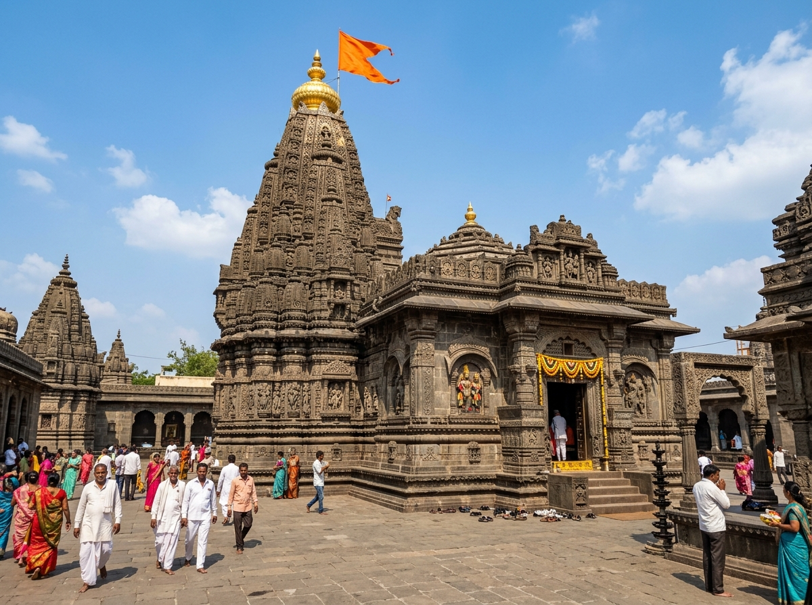

# Pandharpur City Simulator (Pandharpur Darshan 3D)

A 3D simulation of the sacred pilgrimage city of **Pandharpur** coupled with an interactive **Design and Analysis of Algorithms (DAA)** visualizer and learning lab.



---

## 🌟 Overview

**Pandharpur City Simulator** combines real-world cultural cartography with algorithmic engineering. Explore the holy city of Pandharpur in interactive 3D-featuring the historic Shri Vitthal Rukmini Mandir, Chandrabhaga River ghats, and bustling Mahadwar market-while visualizing and analyzing graph traversal and optimization algorithms in real time.

---

## 🚀 Key Features

### 🏛️ 3D Pilgrimage City Simulation
- **Key Sacred Landmarks**: Shri Vitthal Rukmini Mandir, Namdev Payari, Chandrabhaga Ghats, Mahadwar Bazaar, Pundalik Temple, Vishnupad, and more.
- **Dynamic Environment**: Realistic river flow, procedural ghat steps, authentic architecture, dynamic lighting, and crowd simulation.
- **Cinematic & Guided Camera Modes**: Orbit camera, landmark-focused views, street-level perspectives, and guided tours.

### 🧠 DAA Algorithm Visualizer & Lab
- **Dijkstra's Algorithm**: Single-source shortest path finding optimal darshan routes.
- **A* Search**: Heuristic-guided search accounting for Euclidean distances and crowd densities.
- **Breadth-First Search (BFS)**: Unweighted shortest path and level-order exploration.
- **Depth-First Search (DFS)**: Deep maze-like traversal of narrow bazaar alleys.
- **Kruskal's Algorithm**: Minimum Spanning Tree (MST) computation for infrastructure and connecting sacred sites with minimal cost.
- **Multi-Stop Route Planning**: Traveling pilgrimage solver for multi-point itineraries.
- **Step-by-Step Playback**: Step through executions, inspect the frontier, visited sets, costs, and complexity analysis (Time & Space).

### 🎯 Mission Scenarios & Network Editing
- **Interactive Missions**: Solve real pilgrimage logistical challenges (e.g., peak crowd bypass, emergency routes, ghat-to-sanctum tours).
- **Interactive Graph Overlay**: View graph nodes, edges, weights, and crowd congestion multipliers directly on the 3D map.

---

## 🛠️ Tech Stack

- **Frontend**: React 18
- **3D Graphics & Canvas**: Three.js, `@react-three/fiber`, `@react-three/drei`
- **Build Tool**: Vite
- **State Management**: Zustand
- **Icons & UI**: Lucide React, Tailwind CSS / Vanilla CSS

---

## 📦 Getting Started

### Prerequisites
- [Node.js](https://nodejs.org/) (v18+ recommended)
- `npm` or `yarn`

### Installation

1. **Clone the repository**:
   ```bash
   git clone https://github.com/MadhavK3/Pandharpur-City-Simulator.git
   cd Pandharpur-City-Simulator
   ```

2. **Install dependencies**:
   ```bash
   npm install
   ```

3. **Start the development server**:
   ```bash
   npm run dev
   ```

4. **Build for production**:
   ```bash
   npm run build
   ```

---

## 📜 License

This project is open-source under the [MIT License](LICENSE).
